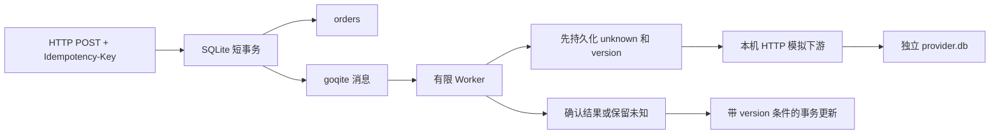

# 一页设计与边界

## 不变量

1. 一个幂等键只能代表同一份 amount_minor + scenario；请求 ID 是排查字段，不参与业务指纹。
2. 本地承诺接收的订单必须有持久化任务；创建失败则两者都不留。
3. 下游超时、连接错误、未知 HTTP 状态、格式错误不等于业务失败。
4. 下游始终用本地 order.id 作为业务号和幂等键；HTTP 重试不换号。
5. 完成状态与删除任务同事务提交；旧 attempt 的结果不能覆盖新 attempt。
6. 有限次数用尽仍不确定时进入 needs_review，不能写成 rejected。

## 数据与流程



```text
pending -> unknown（发请求前写入）
unknown -> succeeded | rejected | unknown | needs_review
终态：succeeded / rejected / needs_review，普通 Worker 不回退
```

首次领取发 POST；再次领取先 GET 原业务号。模拟下游强一致 GET 的 404 代表该号查不到，此时才 POST 原号。GET 超时或 503 时只延后查询，不再 POST。模拟下游以业务号唯一约束保证同号同金额只保存一条 effect。

成功 HTTP 响应必须满足：业务号相同、整数金额相同、状态明确、回执格式正确。错误或伪造格式的“200”不能直接变成功。明确且内容匹配的模拟 422 才是业务拒绝。

## 为什么不是一个大事务

外部 HTTP 无法参加本地 SQLite 事务。把 HTTP 放进事务会长时间占锁，也不能撤销已经受理的外部动作。这里把本地接收和入队合并，把外部不确定性保存在状态中，再查单收敛。

SQLite WAL + synchronous FULL 是本机存储配置，不是硬件掉电、磁盘损坏或跨主机容灾保证。单个 Store 只有一个 SQL 连接，数据库事务串行，HTTP 可以由多个 Worker 并发执行。演示中的服务实例数为 1；未验证多进程竞争或多主机部署。

## 租约与迟到结果

goqite 超时只说明消息可以再次领取，不能杀死旧 Worker。claim 同事务更新消息可见性和订单 version；finish 使用 id + version + unknown 条件更新。过期 Worker 的更新失败后不删任务、不延后新 Worker 的租约。测试额外注入重复消息，验证成功终态不回退。

下游调用可能重叠：version 只隔离本地结果，下游仍需可靠幂等。默认租约 2 秒、HTTP 超时 150 毫秒，降低正常情况下重叠概率；不是安全性证明。

## 重试预算

最多 5 次领取，每次领取在发请求前持久化次数。退避为 250ms × 2^(attempt-1)，指数最多 5，当前预算下最长 2 秒。没有 jitter。进程在最后一次领取后退出，下一次恢复会明确进入 needs_review，而不是靠队列最大领取次数让任务永久消失。

needs_review 是可观察的暂停终态，保存原业务号和错误原因；**没有人工审核、重放入口或正式对账任务**。本实验不会自动把它改成失败，也不会丢弃原记录。

## 未实现与保证边界

- 不是端到端 exactly-once：测试只证明约定的模拟下游，在指定故障模型下最多保存一条 effect。若外部系统无幂等、查单不一致、保留时间有限或业务号可能复用，保证不成立。
- 未支持真实基金申赎、资金账户、份额、估值、清算、监管和对账；`succeeded` 只是模拟下游受理成功，不能理解为真实基金已确认、已成交、已清算。
- 未支持鉴权、多租户、速率限制、CSRF、防公网暴露、正式日志脱敏策略；仅 loopback 学习。
- 无死信人工处理界面、账本、备份恢复、数据库升级脚本、幂等过期回收、告警、指标平台、长任务续租、jitter 或压力容量验证。
- 未实现 webhook/真实乱序回调；测试覆盖的是旧 Worker 返回与重复队列消息。不能据此声称已处理所有回调乱序。
- 崩溃测试是子进程在下游提交后立即 os.Exit；不是主机断电、磁盘损坏、网络分区或双机切换演练。
- 无保证任意第三方错误码语义的通用适配器；生产实现必须先明确提供方合同。
